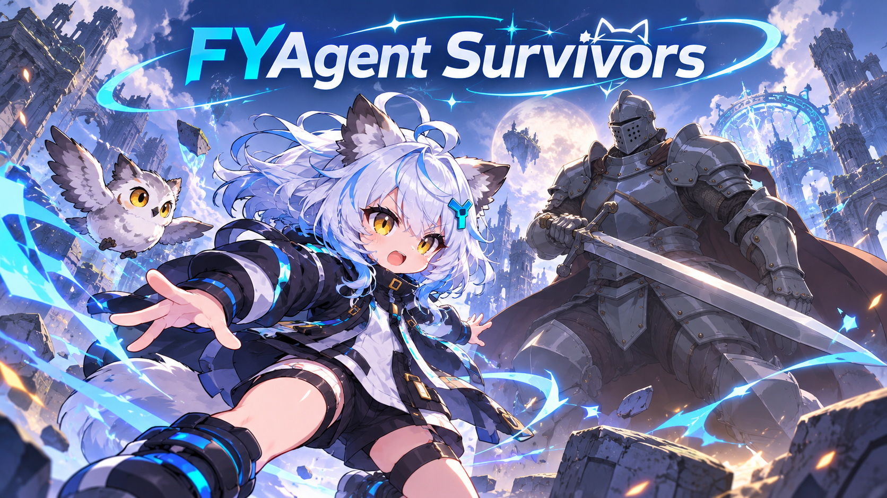

# FYAgent Survivors

俯视角 3D 生存。操作只有wasd上下移动，武器会自动攻击。在敌人的浪潮下撑过 5 分钟，击败赫塞重甲骑士赢得胜利。

<p align="center">
  
</p>

主角是来自未来的机械猫头鹰**小刻**。他落在一条被封住的中世纪土路上，要查清这片地上的怪物从哪来。单局打赢只是活过这一晚。

## 游玩

| 动作 | 键盘 | 手柄 | 触屏 |
| --- | --- | --- | --- |
| 移动 | WASD 或方向键 | 左摇杆 | 左半边拖动 |
| 慢走 / 蓄力 | 按住 Shift。满 2 秒后松手，打出蓄力射击 | 摇杆轻轻推 | — |
| 翻滚 | 空格 | A 或 RT | 右半边双击 |
| 暂停 | Esc | Start | — |
| 升级选择 | 1 / 2 / 3 | 摇杆左右，A 确定 | 点卡片 |
| 查看文书 | E | A | — |

- 走出场地会从对面出现。默认镜头会扫过去，也可以在设置里改成直接出现。
- 沿着土路跑得更快。十字路口那条横路比主路还快。
- 经验攒满会升级，从三张升级卡中选一张。
- 路上有箱子：经验、回复生命、稀有道具，也有陷阱。
- 撑到 5分钟，击败赫塞重甲骑士即通关。

## 本地运行

浏览器即可。页面用 ES modules。Three.js 从 unpkg 加载，第一次打开需要能访问网络。

```bash
python tools/serve.py
```

浏览器打开 [http://127.0.0.1:8133](http://127.0.0.1:8133)。

`tools/serve.py` 是多线程静态服务器。主角模型大约 25 MB，单线程的 `python -m http.server` 会被这一次下载堵住，页面起不来。

## 这一局里有什么

- 自动瞄准的脉冲射击，以及按住 Shift 蓄力后的一发重击。
- 三种史莱姆、猎狗、食人魔，和 5 分钟时出现的四段血 Boss。
- 升级、宝箱、环面场地、土路加速。
- 沿路可以捡起骑士团的文书。叙事写在场景里，不靠开场白。

## 技术

- [Three.js](https://github.com/mrdoob/three.js) r168，用 import map 引入。
- 原生 ES modules。数值在 `js/config.js`，主循环在 `js/main.js`。
- 模型用 Draco 压缩，解码器在 `vendor/draco/`。

## 目录

```
index.html          页面与 HUD
css/hud.css         界面
js/                 玩法与渲染
vendor/draco/       Draco 解码器（Apache-2.0）
assets/             封面与纹章
models/active/      运行时模型
tools/serve.py      本地服务器
LICENSE             非商用协议全文
NOTICE              协议覆盖范围
```

## 模型

运行时模型在 `models/active/`，随仓库一起提供：主角、敌人、场景道具、地面贴图，大约 96 MB。最大的单个文件是主角模型，约 25 MB。

## 许可

原创代码、原创文字，以及 `models/active/` 和 `assets/` 里的原创模型与图片，使用 [PolyForm Noncommercial License 1.0.0](https://polyformproject.org/licenses/noncommercial/1.0.0)。全文在 `LICENSE`，覆盖范围在 `NOTICE`。

可以自己玩、阅读、修改，也可以在非商用前提下再分发。再分发时要带上 `LICENSE` 和 `NOTICE`。

不可以出售、放进收费产品，或用来接商业项目。也不能把这份许可改成允许商用后再发出去。

`vendor/draco/` 是 Google Draco 解码器，随 Three.js 附带，协议是 Apache License 2.0。Three.js 从 unpkg 加载，仍用它自己的协议。这两部分不在上面的非商用协议里。

这条协议不允许商用。
